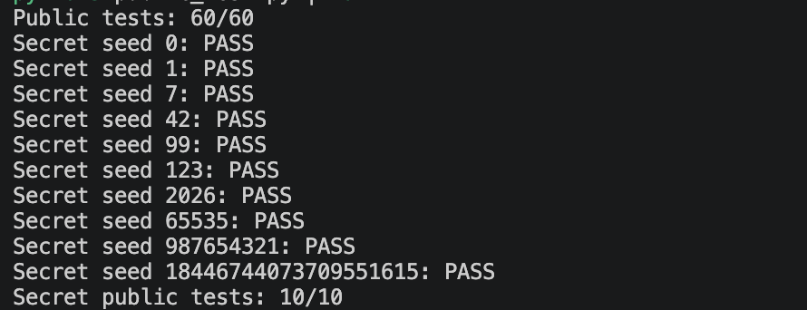
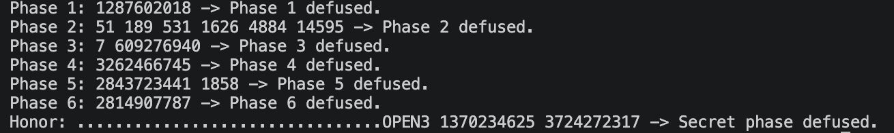

# Lab2: BombLab 实验报告

## 1. 实验环境和分析方法

实验环境为 Linux x86-64，编译器为 GCC 13.3.0，Binutils 版本为 2.42。先用 `nm -n bomb` 确认各关及辅助函数的符号，再用下面的命令导出关键函数的汇编。

```sh
objdump -d -M intel --no-show-raw-insn --disassemble=phase_01 bomb
objdump -d -M intel --no-show-raw-insn --disassemble=p1_compute bomb
```

其他关也使用同样的方法。对跳转表、函数指针表和链表则额外使用 `objdump -s --start-address=... --stop-address=... bomb` 查看 `.rodata` 的原始内容。

下文记号中，`L = (uint32_t)challenge`，`H = (uint32_t)(challenge >> 32)`，所有结果均按 32 位无符号整数自然溢出。

## 2. Phase 1：函数调用与参数传递

`phase_01` 要求输入 1 个整数，并把 `challenge` 传给 `p1_compute`。`p1_compute` 依次调用三个小函数：

```asm
shr    rax,0x20
shr    rdx,0x10
call   p1_step0
call   p1_step1
call   p1_step2
xor    eax,ecx
```

根据 System V AMD64 调用约定跟踪 `edi`/`esi` 可得，令 `M = (uint32_t)(challenge >> 16)`：

```text
a = 5 * (L - H) + 0x215f
b = (M xor 0xfba4) + 8 * H
c = (3 * b) xor (L + 0x3ea6)
answer = c xor a
```

## 3. Phase 2：数组和递推

`valid_u32_fields` 的第二个参数为 6，`sscanf` 也使用了 6 个输出地址。首项比较的关键汇编为：

```asm
shr    rax,0x19
add    eax,eax
and    eax,0x1e
add    eax,0x17
```

之后循环使用从 11 开始、每次增加 2 的移位量。因此六个整数的递推关系为：

```text
a[0] = 2 * ((challenge >> 25) & 15) + 23
a[i] = 3 * (a[i-1] xor (((challenge >> (11 + 2*(i-1))) & 31) + i)), 1 <= i < 6
```

## 4. Phase 3：`switch` 与跳转表

第一个整数必须为 `index = L & 7`。另一个输入与 `p3_dispatch(index, x)` 的返回值比较，其中：

```text
x = (uint32_t)(challenge >> 3) xor H
```

`p3_dispatch` 的间接跳转是 `jmp QWORD PTR [rax*8+0x405820]`。跳转表中的函数顺序与符号名中的数字不同，按表项还原后为：

| `index` | 返回值 |
| ---: | --- |
| 0 | `(x xor 0x6278) + (x >> 2)` |
| 1 | `5*x + 0x1ce80` |
| 2 | `3*x + 0x0ba3` |
| 3 | `2*x xor 0xc6d9` |
| 4 | `4*x xor 0x40ee` |
| 5 | `3*x + 0x57e8` |
| 6 | `(x xor 0x744c) + (x >> 1)` |
| 7 | `5*x + 0x2bde0` |

口令顺序为 `index` 和对应的返回值。

## 5. Phase 4：递归搜索

`phase_04` 调用 `p4_walk(target, 0, 127, salt)`，其中：

```text
target = L & 127
salt = (uint32_t)(challenge >> 7) xor H
```

`p4_walk` 每次取区间中点 `mid = low + (high-low)/2`。关键的三个返回分支为：

```text
target == mid: (mid + 0x6d) xor salt
target <  mid: (3 * walk(target, low, mid-1, salt) xor (mid+salt)) xor 0x8
target >  mid: (3 * walk(target, mid+1, high, salt) xor (mid+salt)) xor 0xc
```

这一过程等价于在 `[0,127]` 上做二分搜索，并把递归路径折叠到最终结果中。

## 6. Phase 5：结构体与链表

`p5_nodes` 中每个节点占 16 字节，布局为 `next` 指针、4 字节 `value` 和 4 字节 `tag`。把地址换成下标后的内容如下：

| 下标 | `next` | `value` | `tag` |
| ---: | ---: | ---: | ---: |
| 0 | 11 | 4 | `0x5495` |
| 1 | 0 | 595 | `0x93d6` |
| 2 | 4 | 2632 | `0xf766` |
| 3 | 7 | 1858 | `0x89bb` |
| 4 | 3 | 1629 | `0x8a5b` |
| 5 | 0 | 369 | `0x7e5e` |
| 6 | 5 | 848 | `0x137a` |
| 7 | 9 | 1088 | `0x3106` |
| 8 | 2 | 1336 | `0xccab` |
| 9 | 1 | 2163 | `0x5ad8` |
| 10 | 8 | 2939 | `0x4865` |
| 11 | 10 | 2438 | `0x6d61` |

8 个头指针对应的节点下标依次为 `{6,5,0,11,10,8,2,4}`。取 `head = heads[L & 7]` 后，计算过程为：

```text
total = ((uint32_t)(challenge >> 6) xor H xor head.tag xor 0x2a2a) + head.value
steps = (challenge >> 3) & 3
重复 steps 次：node = node.next; total = (total xor node.tag) + node.value
```

最后输出 `total` 和停留节点的 `value`。

## 7. Phase 6：函数指针表

`p6_dispatch` 对同一张函数指针表做两次间接调用。按表中的实际位置记操作为 `op[i](x)`：

| `i` | `op[i](x)` |
| ---: | --- |
| 0, 3 | `rol32(x,2) xor 0x86da` |
| 1, 5 | `(x xor (x >> 5)) + 0x3e6c` |
| 2 | `((x << 5) + 0x2e95) xor (7*x)` |
| 4 | `ror32(x,2)` |
| 6 | `(x + 0x69bf) xor (x >> 1)` |
| 7 | `(x xor 0x18ab) + (x << 7)` |

整体关系为：

```text
x0 = (uint32_t)(challenge >> 6) xor H
x1 = op[L & 7](x0)
x2 = op[(L >> 3) & 7](x1 xor 0x4613)
answer = x2 + 0xea73
```

## 8. Honor：输入布局和上下文

`secret_gate` 先将整行复制到栈上局部数组，再检查数组偏移 32 处的 4 字节是否为 `OPEN`：

```asm
lea    r12,[rbp-0xd0]
call   secret_copy
cmp    DWORD PTR [rbp-0xb0],0x4e45504f
lea    rdi,[rbp-0xac]
call   secret_phase
```

因此口令前 32 字节可作为填充，紧接着是 `OPEN`，从第 36 字节开始放置 `secret_phase` 需要的 3 个无符号整数。

`context` 由前六关的完整输出计算。令：

```text
cf = (uint32_t)challenge xor (uint32_t)(challenge >> 32)
tf = (uint32_t)context xor (uint32_t)(context >> 32)
a = (uint32_t)context & 3
b = (rol32(cf xor tf, 7) + 0x7911) xor 0x3ea2
b = b xor (a * 0x7911) xor (uint32_t)(context >> 16)
c = b xor (tf + a + 0x3ea2 + (cf >> 7))
```

最终行格式为 32 个填充字符、`OPEN`，再跟 `a b c`。

## 9. 验证结果

公开测试结果为正式六关 `60/60`，Honor `10/10`。



另选取不在 `tests/public.json` 中的 seed `314159265` 验证所有关卡：

| 关卡 | 解法程序输出 | 结果 |
| --- | --- | --- |
| Phase 1 | `1287602018` | PASS |
| Phase 2 | `51 189 531 1626 4884 14595` | PASS |
| Phase 3 | `7 609276940` | PASS |
| Phase 4 | `3262466745` | PASS |
| Phase 5 | `2843723441 1858` | PASS |
| Phase 6 | `2814907787` | PASS |
| Honor | `................................OPEN3 1370234625 3724272317` | PASS |



除此以外，还对 seed `100000` 至 `100127` 进行了完整七行联调，128 组均通过。

## 10. 参考资料和辅助工具

- [课程 Lab2 实验文档](https://ics-26fall-fdu.github.io/labs/lab2-bomb-lab/)：实验要求、测试和提交格式。
- 仓库内 `README.md` 和 `tutor/README.md`：解法接口、口令格式和调试方法。
- `objdump`、`nm`、`readelf`：查看函数汇编、符号表、跳转表和静态数据。
- GCC 和仓库自带的 `public_test.py`：编译检查和多 seed 验证。
